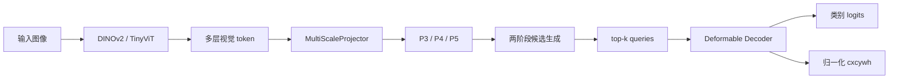

# 01：整体架构

RF-DETR 可以看成两个部分的组合：DINOv2 负责提取视觉特征，LW-DETR 风格的轻量检测器负责把特征转换成一组目标框。



## 为什么使用 DINOv2

DINOv2 是自监督视觉骨干。它输出语义丰富的 patch token，但本身不输出类别和边界框。`DINOv2Backbone` 取指定 Transformer 层，删除 CLS token，再把序列恢复成二维特征图。

## 窗口注意力与全局注意力如何切换

`window_block_indexes` 使用从 0 开始的层号，指定哪些 Transformer block 使用窗口注意力；没有出现在列表中的层使用全局注意力。`num_windows` 表示高度和宽度各切成多少份。

```yaml
model:
  num_windows: 2
  window_block_indexes: [0, 1, 3, 4, 6, 7, 9, 10]
```

上述十二层骨干的执行方式是：

```text
层 0、1       窗口注意力
层 2          全局注意力
层 3、4       窗口注意力
层 5          全局注意力
层 6、7       窗口注意力
层 8          全局注意力
层 9、10      窗口注意力
层 11         全局注意力
```

窗口层把二维 patch 网格分区，各窗口独立执行 self-attention，因而成本明显低于让所有 token 两两交互。全局层重新让整幅图像的 token 交互，用来交换跨窗口信息。DINOv2 的 CLS 等前缀 token 会复制到每个窗口，完成窗口层后再取平均。

教学实现允许 patch 网格不能被窗口数整除。此时会生成尺寸尽量接近的非等大窗口，不通过补零伪造图像 token。`local_smoke.yaml` 使用交替窗口层方便观察；两个 RAOD 配置使用接近 RF-DETR 思路的“若干窗口层后插入一个全局层”布局。

## 为什么需要多尺度特征

DINOv2 的几个中间层空间尺寸相同。`MultiScaleProjector` 按官方 RF-DETR/LW-DETR 的方式，为每个目标尺度分别处理所有中间层：先把每层独立上采样、保持尺寸或下采样，再在通道维拼接，最后通过 C2f 和二维 LayerNorm 融合。它生成：

- P3：上采样，保留更多空间细节。
- P4：保持 patch 特征分辨率。
- P5：下采样，获得更大感受野。

这对 RAOD 中尺寸较小的遗落物尤其重要。

```text
四个中间层 ──各自上采样 2 倍──→ 通道拼接 → C2f → P3
四个中间层 ──保持原始尺寸────→ 通道拼接 → C2f → P4
四个中间层 ──各自下采样 2 倍──→ 通道拼接 → C2f → P5
```

这种融合保留了不同深度特征的独立通道信息；旧教学实现使用逐元素平均，会提前混合并丢失这部分信息，现已移除。

## 为什么先产生 proposals

普通 DETR 从完全学习的 object query 开始。这里先让每个多尺度网格位置预测类别和框，再选择得分最高的 top-k 位置作为 Decoder 初值。这就是 `TwoStageQueryInitializer`。

## 为什么使用 Deformable Attention

普通 cross-attention 会让每个 query 查看所有图像 token。Deformable Attention 围绕 reference box 只采样少量位置，计算量随采样点数量增长，适合高分辨率和多尺度特征。

## 练习

1. 在 `local_smoke.yaml` 中把 queries 从 50 改成 25，观察 logits 的第二维。
2. 注释 P3，只使用 P4/P5，比较 RAOD 小目标的 AP。
3. 打印每层 reference box 的均值，观察 Decoder 是否逐层改变框。
4. 给各 Transformer 层注册 forward hook，比较窗口层与全局层看到的 token 数量。
